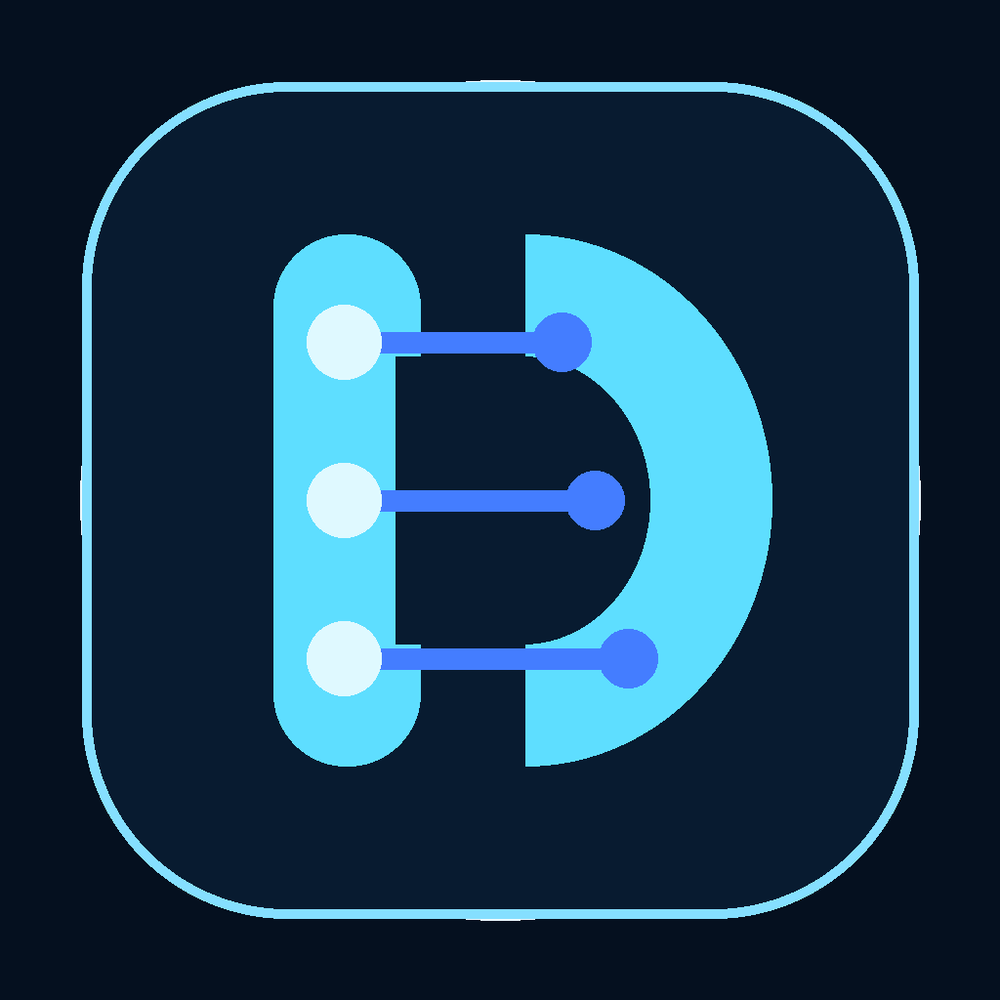
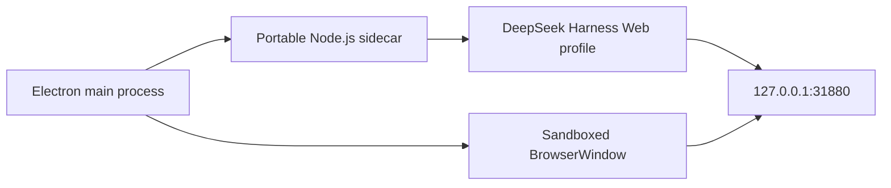

<p align="center">
  
</p>

# DeepSeek Harness Desktop

Community-maintained Windows desktop shell for [DeepSeek Harness](https://github.com/deepseek-ai/deepseek-harness). It runs the upstream Web UI inside a hardened Electron window and ships a dedicated Node.js sidecar runtime.

基于 DeepSeek Harness 官方 Web UI 的 Windows 桌面封装：内置运行时、原生窗口、独立数据目录和完整安装程序。

## Features / 特性

- Original DeepSeek Harness Web UI in an Electron desktop window
- Bundled Node.js, npm, Corepack, pnpm, and pinned `@deepseek-ai/dsh`
- Stable loopback endpoint at `127.0.0.1:31880`, with automatic fallback on conflict
- First-run workspace picker plus `--workspace` and `DSH_WORKSPACE` overrides
- Separate desktop `DSH_HOME`; existing `DEEPSEEK_API_KEY` or `~/.deepseek/config.toml` is reused locally
- Single-instance lock, sandboxed renderer, external-link isolation, and IPC-based runtime shutdown

## Download / 下载

Download the latest Windows x64 installer from [GitHub Releases](https://github.com/Tlenzer/deepseek-harness-desktop/releases/latest).

安装后从桌面或开始菜单启动。首次启动时选择项目工作区，随后在 DeepSeek Harness 界面中选择具体项目并创建会话。

## Architecture / 架构



The Harness runtime stays outside `app.asar` so native modules, workers, terminal helpers, and Web assets remain ordinary filesystem resources. The renderer has Node integration disabled and context isolation enabled.

## Build from source / 从源码构建

Requirements:

- Windows x64
- Node.js `22.19+` or `24+` (Node.js 24 recommended)
- Git

```powershell
git clone https://github.com/Tlenzer/deepseek-harness-desktop.git
cd deepseek-harness-desktop
npm ci
npm run runtime:install
npm run check
npm run smoke
npm run dist
```

Artifacts are written to `release/`.

Development mode:

```powershell
npm start
npm start -- --workspace C:\path\to\workspace
```

## Data locations / 数据目录

```text
%APPDATA%\deepseek-harness-desktop\desktop-settings.json
%APPDATA%\deepseek-harness-desktop\desktop.log
%APPDATA%\deepseek-harness-desktop\dsh\
```

## Runtime privacy / 运行时信息

The Node.js sidecar inherits the desktop process environment so provider keys, proxy settings, and tool configuration continue to work. `desktop.log` can contain workspace paths and Harness stdout/stderr; review that file before sharing it in an issue.

Release installers are community builds without a commercial Windows signing certificate. Reproducible workflow artifacts and SHA-256 checksums are generated for every tagged release.

## Version policy

Desktop releases pin an exact DeepSeek Harness release in `runtime/package.json`. Upstream is currently a developer preview, so dependency upgrades are tested and released explicitly rather than floating on npm `latest`.

## License

This desktop shell is released under the [MIT License](LICENSE). DeepSeek Harness and bundled third-party components retain their respective licenses; see [NOTICE.md](NOTICE.md) and [THIRD_PARTY_LICENSES.txt](THIRD_PARTY_LICENSES.txt).
